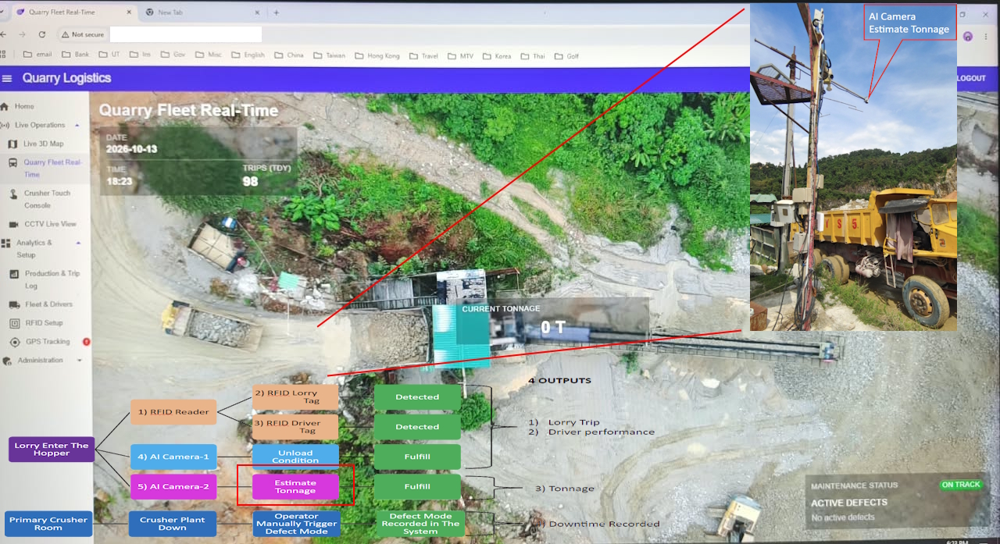
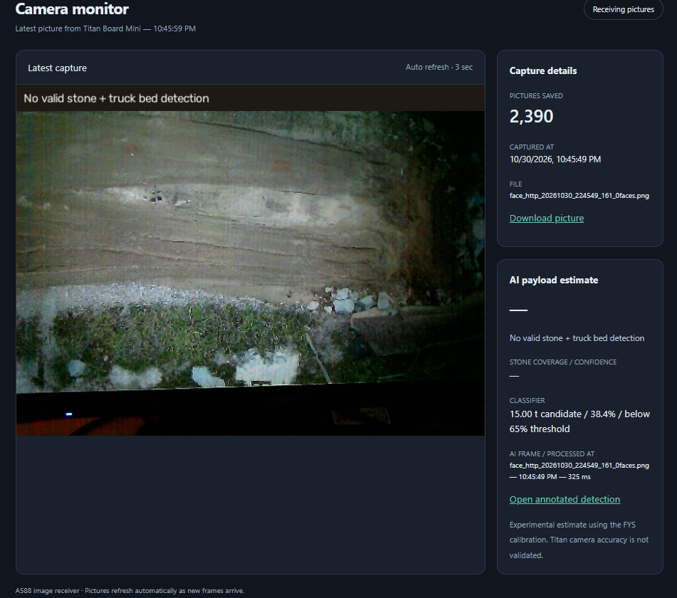
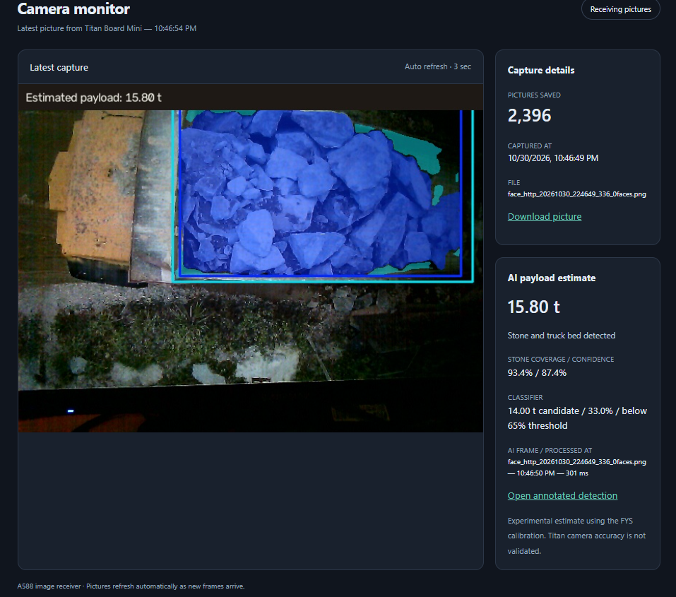
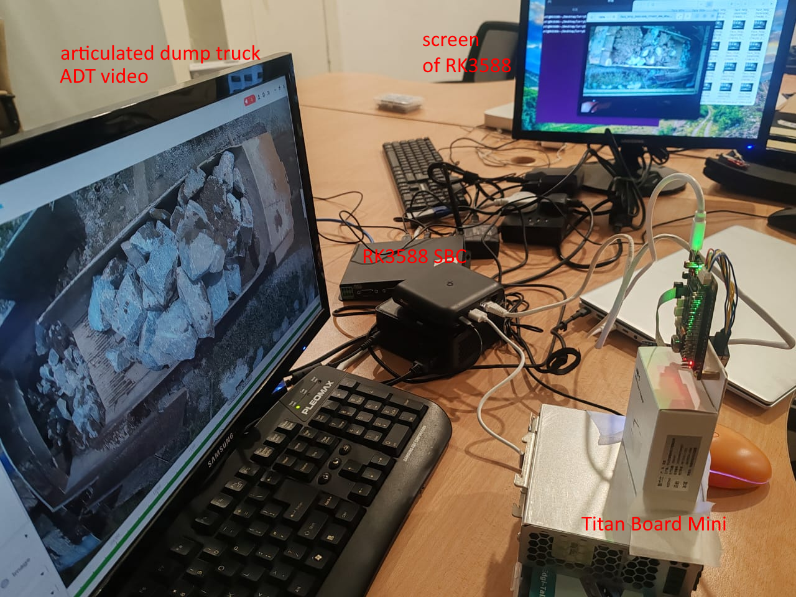
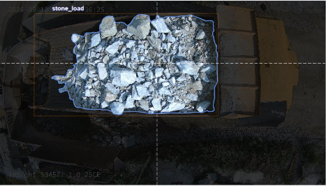
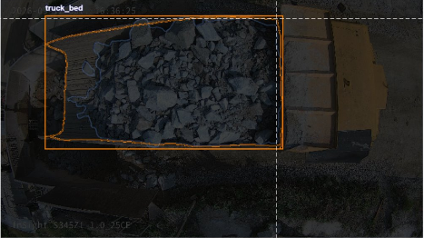

# Titan Board Mini AI Payload for Quarry Truck
Documentation of featured Titan Board Mini for AI payload detection
a collection of titan board and titan board mini projects

# Projects Table of Contents
 Project name  | details |
| ------------- | ------------- |
| Titan_Board_Mini_Lorry_Capture | Titan Mini: capture + upload, runs standalone (no terminal), LED toggles on each upload, send to edge gateway for AI payload |
|titan_mini_npu_ai_face_detection  | from titan mini built in example (used as reference) |
| Titan_Board_Lorry_Capture | Titan Board: auto-captures a frame every 10s and uploads to a PC over Ethernet HTTP (used for debugging) |

# Solution Overview
In granite quarry, it is important to have digitalization of the production process, where the quarry real-time production process can be monitored. One of the major measurement is the payload of an articulated
dump truck (ADT) as it dump the stone at primary crusher. Conventional measurement system like weighing bridge is expensive and impractical to be installed at crusher site, in addition to terrain and space limitation. A weighing bring will easily cost > RM100,000. Alternative like installing load cell at each ADT involves major rework on the ADT and is also costly at RM25,000 per truck. A fleet of 10 trucks will easily requires a capital investment of over RM250,000.
Off the shelf LIDAR volumetric measurement system is also expensive at >RM350,000. In this solution, we attempt to use low cost camera such as CCTV and in this example, Titan Board as the AI camera. It will feed image stream ADT to edge 
gateway, where the logic and AI to determine the payload is carried out. 

*Figure 1* The lorry haulage web app at quarry. This project with Titan Board Mini focus on "Estimate Tonnage". Enlarge view of the ADT with camera is at top right of this image

No truck detected             |  Payload estimation
:-------------------------:|:-------------------------:
  |  
the web app indicates no truck and no payload is estimated|truck is detected and payload is estimated as 15.8t

*Figure 2* screenshot of the web app when truck is not detected and when truck is detected

[Video of the system working](https://www.youtube.com/watch?v=l13ZbLLVUZg)


# Setup References
## Setting up titan board mini
refer to [Titan Board Mini 开发板](https://www.rt-thread.org/document/site/#/rt-thread-version/rt-thread-standard/hw-board/ra8p1-titan-board-mini/ra8p1-titan-board-mini?id=titan-board-mini-%e5%bc%80%e5%8f%91%e6%9d%bf)

# system architecture
in order to easily used for development at office, the Titan Board Mini with camera is setup to view at recorded playback video of articulated dump truck (ADT) / lorry at a granite quarry
the Titan Board mini will send the photo to edge gateway (A588 powered by RK3588). A web app is running on A588 that shows the detected payload using AI. 


photo below shows the setup used for this project


# AI Development
## End-to-End System Data Pipeline
The pipeline automatically converts 2D overhead camera images into calibrated, continuous net payload estimates (e.g., `14.46 t`). 

> [!NOTE]
> The legacy class-based system that predicted fixed integers (13t, 14t, 15t) is now deprecated.

### Workflow Sequence
1. **Camera Image** Capture via live RTSP stream.
2. **YOLO Segmentation** runs frame-by-frame using `YOLO11n-seg`.
3. **Mask Generation** creates `stone_load` and `truck_bed` pixel masks.
4. **Visible Coverage Percentage** is calculated for each frame.
5. **Median Filtering** stabilizes results over several valid frames.
6. **Coverage-to-Weight Formula** estimates net payload tonnes.
7. **Quarry API Submission** pushes data to the backend system.
8. **AI Tonnage Dashboard** updates the website display.

---

## Data Preparation & Annotation

Standard rectangular bounding boxes include empty corner pixels. Therefore, **Instance Segmentation (Polygon Paths)** is used to trace irregular rock shapes tightly.

### Classes Defined
*   **`stone_load` (Class 0):** All visible granite aggregate material inside the truck bed.
*   **`truck_bed` (Class 1):** The entire visible interior floor space of the lorry (loaded + empty parts).

class 0            | class 1
:-------------------------:|:-------------------------:
 |  


*Figure 4* Annotation

### Annotation Methodology
*   **Workspace:** Processed entirely within the **Roboflow** platform.
*   **Tracing:** Tight manual placement of multiple nodes along uneven rock edges.
*   **YOLOv8 Export:** Saves image files matching exactly with normalized 2D coordinate text labels (File Synchronicity).

### Current Dataset Breakdown

| Tonnage Class | Number of Images |
| :--- | :--- |
| `low_load` | 212 |
| `medium_load` | 338 |
| `high_load` | 352 |
| **Total Annotated** | **902 images** (New un-deployed dataset) |

*Note: The currently deployed model uses a consolidated sub-dataset of 875 images (after excluding 4 invalid annotations).*

---

## AI Segmentation Training Pipeline

The backend training cycle is fully automated via bat file.

> [!IMPORTANT]
> The AI model training strictly teaches boundary detection; weight calibration is handled downstream as a separate mathematical process.

---

## Pixel Analytics & Multi-Frame Stabilization

Live production frames are highly vulnerable to environmental noise such as dust clouds, moving materials, and dynamic shadows. 

### 1. Coverage Equation
\[\text{Visible Coverage (\%)} = \frac{\text{stone\_pixels}}{\text{stone\_pixels} + \text{visible\_empty\_truck-bed\_pixels}} \times 100\]

* **Production Example:** `85,000` stone pixels / `100,000` total bed area = **85% Visible Coverage**.

### 2. Multi-Frame Noise Stabilization (The Median Solution)
The system samples frame coverages inside a **30-second observation window** and computes the **Median Coverage** to filter out anomalous frames.

*   **Sample Window Frames:** `84.9%`, `85.5%`, `85.2%`, `91.0%` (anomaly), `85.4%`.
*   **Stabilized Output:** **`85.4%`**.

---

## Mathematical Weight Estimation & Validation

The stabilized median coverage (x) is converted into net payload tonnes using a calibrated quadratic formula.

### The Calibration Equation
\[\text{Estimated Weight (t)} = 4.1667415685 + 0.0746357414(x) + 0.0005351320(x^2)\]

* **Validation Metric:** A stabilized coverage of **`85.48%`** accurately maps to an estimated net payload of **`14.46 t`**.

### Model Selection & Evaluation Rules
Models are cross-matched against actual physical weighbridge (FYS) weights using unloading timestamps. Production models are selected based on the lowest **Leave-One-Date-Out MAE** to guarantee performance on unseen dates.

*   **MAE / RMSE:** Evaluates average absolute tonnage errors (lower is better).
*   **Bias:** Identifies systematic overestimation (positive) or underestimation (negative).
*   **Within_1t / Within_2t:** Total count of predictions falling within ± 1 or ± 2 tonnes of actual weighbridge values.

---

## Edge Deployment & Live Inference

### Production Loop
1. API detects arrival of a hauling lorry.
2. Worker script processes live RTSP stream over a 30s window.
3. Model extracts stabilized median frames and processes tonnage.
4. Results are pushed via `POST` to `/api/trips/ai-tonnage` paired with the vehicle's EPC tag.

### Failure & Exception Handling
If an observation window is incomplete, an API network drops, or an EPC tag mismatch occurs, the pipeline flags the record as `Submitted: False` to trigger engineering alerts.

### Live Production Log Sample
```text
[ACTIVE] Trip detected – segmentation coverage started (30s window).
[2026-10-13 11:11:59] Lorry 4 | Coverage: 91.47% | Valid: 1 | Est: 15.47 T | Submitted: Pending
[2026-10-13 11:12:04] Lorry 4 | Coverage: 91.31% | Valid: 2 | Est: 15.44 T | Submitted: Pending
[2026-10-13 11:12:24] Lorry 4 | Coverage: 91.45% | Valid: 6 | Est: 15.47 T | Submitted: Pending
[API SUCCESS] (Coverage Formula) Pushed AI Tonnage -> EPC: E200471816D060272DD9010E | 91.5% (15.47 T)
[2026-10-13 11:12:29] Lorry 4 | Coverage: 91.45% | Valid: 6 | Est: 15.47 T | Submitted: True
```

