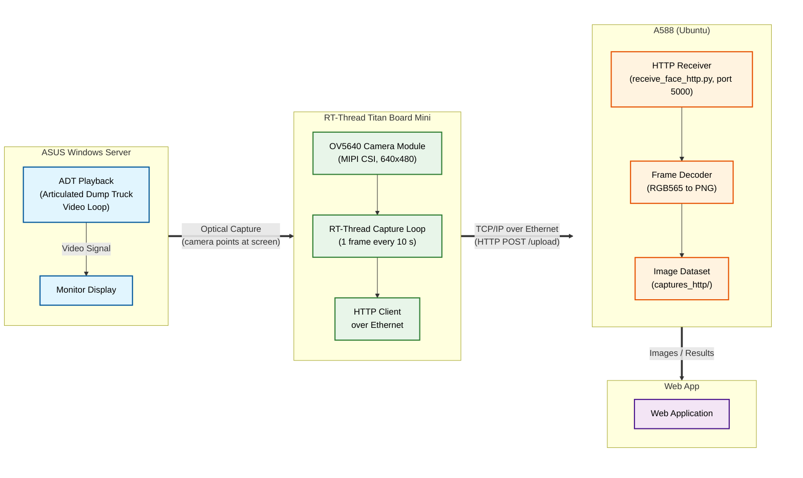

# Titan Board Mini AI Payload for Quarry Truck
Documentation of featured Titan Board Mini for AI payload detection
a collection of titan board and titan board mini projects

# Projects Table of Contents
 Project name  | details |
| ------------- | ------------- |
| Titan_Board_Mini_Lorry_Capture | Titan Mini: capture + upload, runs standalone (no terminal), LED toggles on each upload, send to edge gateway for AI payload |
|titan_mini_npu_ai_face_detection  | from titan mini built in example (used as reference) |
| Titan_Board_Lorry_Capture | Titan Board: auto-captures a frame every 10s and uploads to a PC over Ethernet HTTP (used for debugging) |

# Solution Overview
In granite quarry, it is important to have digitalization of the production process, where the quarry real-time production process can be monitored. One of the major measurement is the payload of an articulated
dump truck (ADT) as it dump the stone at primary crusher. Conventional measurement system like weighing bridge is expensive and impractical to be installed at crusher site, in addition to terrain and space limitation. A weighing bring will easily cost > RM100,000. Alternative like installing load cell at each ADT involves major rework on the ADT and is also costly at RM25,000 per truck. A fleet of 10 trucks will easily requires a capital investment of over RM250,000.
Off the shelf LIDAR volumetric measurement system is also expensive at >RM350,000. In this solution, we attempt to use low cost camera such as CCTV and in this example, Titan Board as the AI camera. It will feed image stream ADT to edge 
gateway, where the logic and AI to determine the payload is carried out. 

[Video of the system working](https://www.youtube.com/watch?v=l13ZbLLVUZg)

# Setup References
## Setting up titan board mini
refer to [Titan Board Mini 开发板](https://www.rt-thread.org/document/site/#/rt-thread-version/rt-thread-standard/hw-board/ra8p1-titan-board-mini/ra8p1-titan-board-mini?id=titan-board-mini-%e5%bc%80%e5%8f%91%e6%9d%bf)

# system architecture
in order to easily used for development at office, the Titan Board Mini with camera is setup to view at recorded playback video of articulated dump truck (ADT) / lorry at a granite quarry
the Titan Board mini will send the photo to edge gateway (A588 powered by RK3588). A web app is running on A588 that shows the detected payload using AI. 

photo below shows the setup used for this project

