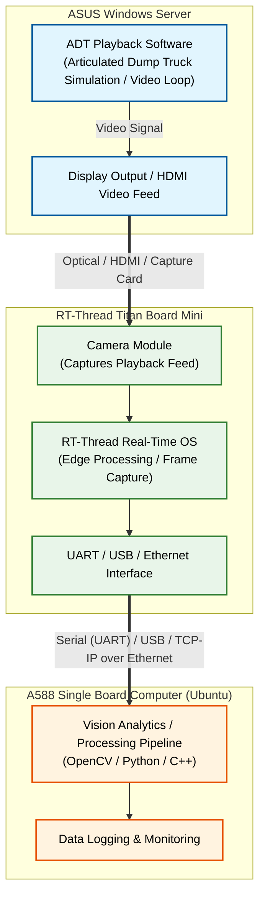

# titan_app
a collection of titan board and titan board mini projects

# Projects TOC
 Project name  | details |
| ------------- | ------------- |
|titan_mini_npu_ai_face_detection  | from titan mini built in example  |
| Titan_Board_Lorry_Capture | Titan Board: auto-captures a frame every 10s and uploads to a PC over Ethernet HTTP (used for debugging) |
| Titan_Board_Mini_Lorry_Capture | Titan Mini: same capture + upload, runs standalone (no terminal), LED toggles on each upload |

# Setup References
## Setting up titan board mini
refer to [Titan Board Mini 开发板](https://www.rt-thread.org/document/site/#/rt-thread-version/rt-thread-standard/hw-board/ra8p1-titan-board-mini/ra8p1-titan-board-mini?id=titan-board-mini-%e5%bc%80%e5%8f%91%e6%9d%bf)

# system architecture

